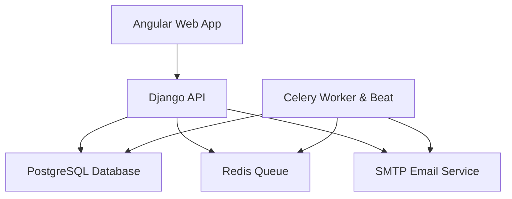
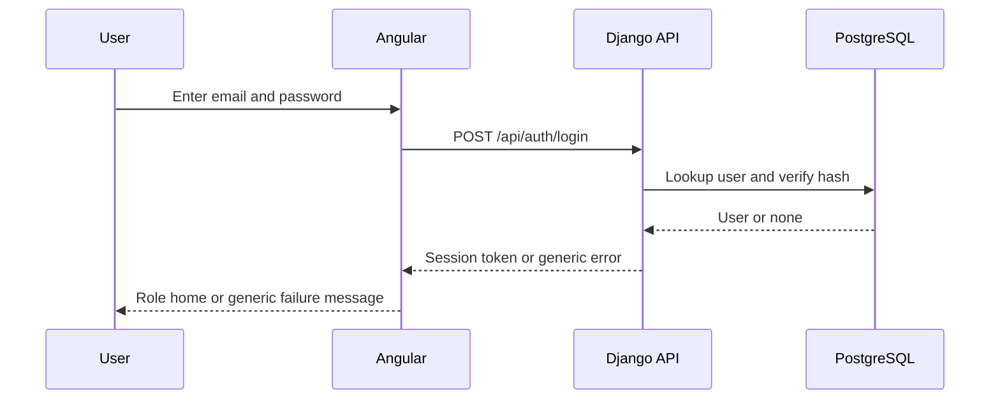
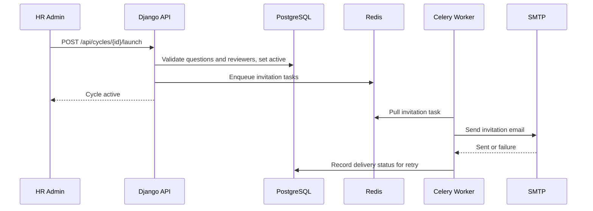
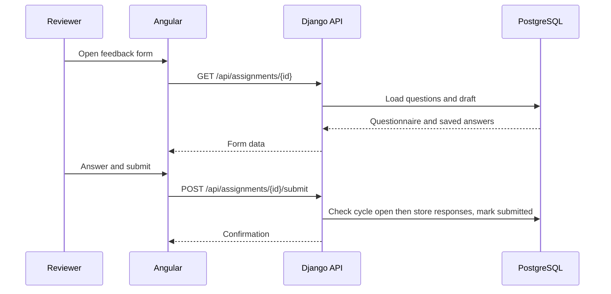
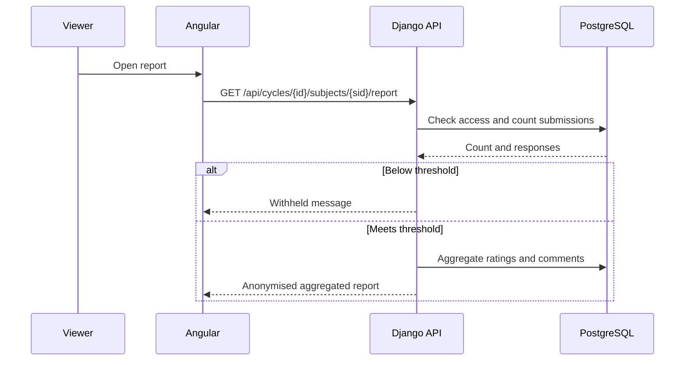
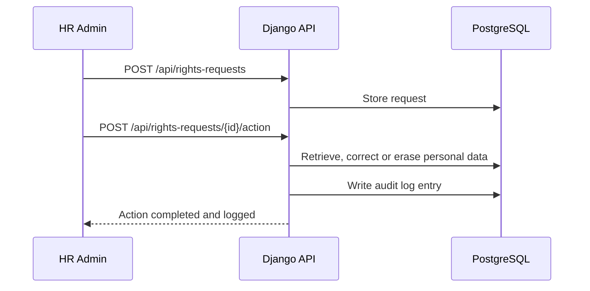
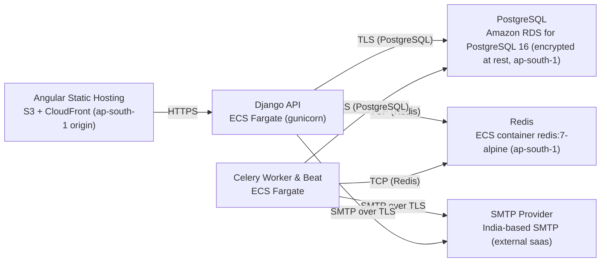

# Architecture

> Maintained by QuorQ AI SDLC. Text between `sdlc:auto` markers is regenerated; anything outside them is yours and is kept.

<!-- sdlc:auto:start narrative -->
## Overview

### ARCH-OVERVIEW · draft · source: architecture:summary

Architecture v1 (status: generated) delivers the lightweight 360° feedback system as an Angular 22 SPA over a Django 5.1/DRF API, PostgreSQL 16, Celery+Redis background jobs and SMTP email, fully hosted in AWS Mumbai (ap-south-1) for DPDP residency.

Covers HR/admin directory and reporting-line management, cycle/questionnaire setup, subject/reviewer selection, dashboard tracking, background email invitations/reminders, anonymous feedback submission, threshold-gated aggregated reporting with PDF export, privacy-notice acknowledgement, DPDP rights requests and audit logging -- matching the requirements epics one-to-one.

**Related:** REQ-TECHSTACK

- ⚠ Architecture status is 'generated', not explicitly marked as approved by a human reviewer.

### ARCH-COMP-WEB · draft · source: architecture:component:web

Angular 22 role-aware SPA covering sign-in, directory, cycle/questionnaire setup, reviewer assignment, feedback submission, reports and the HR dashboard.

Also presents the DPDP privacy notice. Technology decision notes Angular CDK a11y and semantic components to address RPwD Act 2016 / WCAG accessibility.

**Related:** EPIC-001, EPIC-002, EPIC-003, EPIC-006, EPIC-007, EPIC-008

### ARCH-COMP-API · draft · source: architecture:component:api

Django 5.1 + DRF API handling authentication, RBAC, directory/reporting-line logic, cycle/questionnaire/reviewer logic, anonymity/threshold enforcement, report aggregation, PDF generation, DPDP rights requests and audit logging.

Anonymity and threshold logic explicitly stated to live in server-side services (not the frontend), consistent with NFR-004/NFR-005.

**Related:** EPIC-001, EPIC-002, EPIC-003, EPIC-005, EPIC-006, EPIC-008

### ARCH-COMP-WORKER · draft · source: architecture:component:worker

Celery Worker & Beat runs background/scheduled jobs: send invitations on launch, send scheduled/triggered reminders, record delivery failures for HR retry.

Driven by the Redis queue; ensures HR is not blocked waiting on email delivery.

**Related:** EPIC-004, NFR-009

### ARCH-COMP-DB · draft · source: architecture:component:db

PostgreSQL 16, encrypted at rest, stores all relational data: employees, reporting lines, cycles, questionnaires, assignments, responses, email logs, privacy acknowledgements, rights requests and audit logs.

Strictness of relational joins is relied on to enforce anonymity and the minimum-reviewer threshold correctly.

**Related:** NFR-007

### ARCH-COMP-QUEUE · draft · source: architecture:component:queue

Redis 7 message broker carries invitation and reminder tasks for Celery.

Deployed as container redis:7-alpine.

**Related:** EPIC-004

### ARCH-COMP-EMAIL · draft · source: architecture:component:email

SMTP transactional email service delivers reviewer invitations, reminders and password-reset links via an India-based SMTP provider.

Config via env vars SMTP_HOST/PORT/USER/PASSWORD, matching the requirements' approved services list.

**Related:** EPIC-004, EPIC-001

### ARCH-CP-AUTH · draft · source: architecture:critical-path:auth

Sign-in and role-based access critical path.

User authenticates with email/password, receives a session/JWT; every protected request is checked against role and (for reports) reporting line; failed sign-in returns one generic error to avoid account enumeration.

**Related:** US-001, US-002, NFR-001

### ARCH-CP-LAUNCH · draft · source: architecture:critical-path:launch

Launch cycle and invite reviewers critical path.

HR launches a configured cycle; API validates questionnaire and reviewers, marks the cycle active, enqueues invitation emails via Redis; worker sends mail over SMTP and records any failure for HR retry.

**Related:** US-007, US-011, NFR-009

### ARCH-CP-SUBMIT · draft · source: architecture:critical-path:submission

Anonymous feedback submission critical path.

Reviewer opens assigned request, answers rating-scale and open-text questions, can save partial progress, and submits; responses stored against cycle/subject without exposing reviewer identity; submission blocked once cycle is closed.

**Related:** US-013, US-014

### ARCH-CP-REPORT · draft · source: architecture:critical-path:report

Aggregated report with anonymity threshold critical path.

Authorised viewer requests a report; API checks access, counts submitted reviewers, returns aggregated ratings plus collated comments with no identities, or withholds below threshold; PDF export reuses the same gate.

**Related:** US-015, US-016, NFR-005

### ARCH-CP-DPDP · draft · source: architecture:critical-path:dpdp

DPDP rights request and audit logging critical path.

HR records an access/correction/erasure request against an employee and actions it in-app; erasure removes personal data while retaining anonymised aggregates that cannot re-identify anyone; every action and privacy-notice acknowledgement is written to the audit log.

**Related:** US-019, US-020

### ARCH-ENTITIES · draft · source: architecture:entities

Data model: employee, password_reset_token, cycle, question, cycle_subject, reviewer_assignment, response, email_log, privacy_notice_ack, data_rights_request, audit_log.

Key fields: employee(id, name, work_email, password_hash, role, manager_id, is_active, is_erased, created_at); password_reset_token(id, employee_id, token_hash, expires_at, used_at); cycle(id, name, review_period, start_date, end_date, status, min_reviewers, created_by); question(id, cycle_id, type, text, scale_max, display_order); cycle_subject(id, cycle_id, subject_id); reviewer_assignment(id, cycle_subject_id, reviewer_id, relationship, access_token, status, submitted_at); response(id, reviewer_assignment_id, question_id, rating_value, text_value, is_draft); email_log(id, cycle_id, reviewer_assignment_id, email_type, status, error_detail, sent_at); privacy_notice_ack(id, employee_id, notice_version, acknowledged_at); data_rights_request(id, employee_id, request_type, status, requested_at, actioned_by, actioned_at, notes); audit_log(id, actor_id, action, target_type, target_id, detail, created_at).

**Related:** EPIC-001, EPIC-002, EPIC-003, EPIC-004, EPIC-005, EPIC-006, EPIC-008

### ARCH-ENDPOINTS · draft · source: architecture:endpoints

19 planned REST endpoints across auth, directory, cycles, assignments, reports, privacy notice and rights requests.

Auth: POST /api/auth/login, /logout, /password-reset/request, /password-reset/confirm. Directory: GET/POST /api/employees, PATCH /api/employees/{id}. Cycles: POST /api/cycles, POST /api/cycles/{id}/questions, POST /api/cycles/{id}/subjects, GET /api/cycles/{id}/subjects/{sid}/suggested-reviewers, POST /api/cycles/{id}/launch, POST /api/cycles/{id}/close, POST /api/cycles/{id}/reminders, GET /api/cycles/{id}/dashboard. Assignments: GET /api/assignments/{id}, PUT /api/assignments/{id}/draft, POST /api/assignments/{id}/submit. Reports: GET /api/cycles/{id}/subjects/{sid}/report, GET .../report.pdf. Privacy/rights: POST /api/privacy-notice/acknowledge, POST /api/rights-requests, POST /api/rights-requests/{id}/action.

**Related:** EPIC-001, EPIC-002, EPIC-003, EPIC-004, EPIC-005, EPIC-006, EPIC-007, EPIC-008

### ARCH-DEPLOY · draft · source: architecture:deployment-nodes

All compute and data run in AWS ap-south-1 (Mumbai): static Angular hosting on S3+CloudFront, Django API and Celery worker on ECS Fargate, PostgreSQL on encrypted RDS, Redis on ECS container, SMTP via an India-based external SaaS provider.

Nodes: Angular Static Hosting (S3 + CloudFront, ap-south-1 origin); Django API (ECS Fargate, gunicorn, Python 3.12/Django 5.1); Celery Worker & Beat (ECS Fargate, Python 3.12/Celery); PostgreSQL (Amazon RDS for PostgreSQL 16, encrypted at rest, ap-south-1); Redis (ECS container redis:7-alpine, ap-south-1); SMTP Provider (India-based SMTP, external SaaS).

**Related:** NFR-007, NFR-010

- ⚠ No deployment has actually occurred yet per the deployment phase input -- these are planned nodes only, not a confirmed live environment.

### ARCH-TECH · draft · source: architecture:technology-decisions

Architecture restates and justifies the approved stack: Angular 22, Django 5.1, PostgreSQL 16, AWS.

DPDP Act 2023: data residency. AWS ap-south-1 hosts all compute/data in India; RDS encryption at rest and TLS in transit protect sensitive employee/feedback data; CloudWatch logs are cited as 'supporting CERT-In retention' though no specific retention duration or incident-reporting workflow is detailed. Angular 22 chosen over React/Vue for built-in HttpClient/router/forms and CDK accessibility. Django 5.1 chosen over FastAPI/Flask for built-in admin/auth/permissions enforcing RBAC and DPDP rights actions. PostgreSQL 16 chosen over MySQL/SQLite for strict relational integrity underpinning anonymity/threshold logic; JSONB/full-text noted as available for future structured notes/search.

**Related:** REQ-TECHSTACK, NFR-007

- ⚠ CERT-In's required 180-day ICT log retention and 6-hour incident reporting process are not explicitly configured or documented beyond a general reference to CloudWatch logs.
<!-- sdlc:auto:end narrative -->

<!-- sdlc:auto:start building-blocks -->
## Building Block View

| ID | Name | Technology | Responsibility | Depends on |
|---|---|---|---|---|
| web | Angular Web App | Angular 22 | Role-aware SPA for sign-in, employee directory, cycle/questionnaire setup, reviewer assignment, feedback submission, reports and HR dashboard; presents the privacy notice. | api |
| api | Django API | Django 5.1 (Django REST Framework) | Authentication, role-based access control, directory and reporting-line management, cycle/questionnaire/reviewer logic, anonymity and threshold enforcement, report aggregation and PDF generation, DPDP rights requests and audit logging. | db, queue, email |
| worker | Celery Worker & Beat | Celery on Django 5.1 | Runs background and scheduled jobs: send reviewer invitations on launch, send scheduled/triggered reminders to outstanding reviewers, record delivery failures for HR retry. | queue, db, email |
| db | PostgreSQL Database | PostgreSQL 16 | Strictly relational store for employees, reporting lines, cycles, questionnaires, assignments, responses, email logs, privacy acknowledgements, rights requests and audit logs; enforces anonymity and threshold joins. Encrypted at rest. | — |
| queue | Redis Queue | Redis 7 | Message broker for Celery carrying invitation and reminder tasks so HR is never blocked. | — |
| email | SMTP Email Service | SMTP | Transactional email delivery for reviewer invitations, reminders and password-reset links via an India-based SMTP provider. | — |

<!-- sdlc:auto:end building-blocks -->

<!-- sdlc:auto:start runtime -->
## Runtime View

### Sign-in and role-based access

User authenticates with email/password, receives a session/JWT, and every protected request is checked against the user's role and (for reports) reporting line. Failed sign-in returns a single generic error to avoid account enumeration.

- **Components:** web, api, db
- **Modules:** accounts.views, accounts.permissions, accounts.serializers
- **Key functions:** sign_in(email, password), sign_out(session), has_report_access(user, subject), require_role(roles)

### Launch cycle and invite reviewers

HR launches a configured cycle; the API validates questionnaire and reviewers, marks the cycle active, and enqueues invitation emails to each reviewer via Redis. The worker sends mail over SMTP and records any failure for HR retry.

- **Components:** web, api, db, queue, worker, email
- **Modules:** cycles.views, cycles.services, notifications.tasks, notifications.email_log
- **Key functions:** launch_cycle(cycle_id), validate_questionnaire(cycle), enqueue_invitations(cycle), send_invitation(assignment_id), record_email_failure(assignment_id, error)

### Anonymous feedback submission

A reviewer opens their assigned request, answers rating-scale and open-text questions, can save partial progress, and submits. Responses are stored against the cycle and subject without exposing reviewer identity; submission is blocked once the cycle is closed.

- **Components:** web, api, db
- **Modules:** feedback.views, feedback.serializers, feedback.services
- **Key functions:** get_assignment(token, user), save_draft(assignment_id, answers), submit_feedback(assignment_id, answers), assert_cycle_open(cycle)

### Aggregated report with anonymity threshold

An authorised viewer (subject, their manager or HR) requests a report. The API checks access, counts submitted reviewers, and either returns aggregated ratings plus collated comments with no identities, or withholds it when below the minimum threshold. PDF export reuses the same gate.

- **Components:** web, api, db
- **Modules:** reports.views, reports.aggregation, reports.pdf
- **Key functions:** can_view_report(user, subject, cycle), count_submitted_reviewers(cycle, subject), aggregate_report(cycle, subject), render_report_pdf(report)

### DPDP rights request and audit logging

HR records an access, correction or erasure request against an employee and actions it in-app. Erasure removes personal data while retaining anonymised aggregates that cannot re-identify anyone. Every action and privacy-notice acknowledgement is written to the audit log.

- **Components:** web, api, db
- **Modules:** privacy.views, privacy.services, privacy.audit
- **Key functions:** record_rights_request(employee, type), action_access(employee), action_correction(employee, changes), action_erasure(employee), write_audit(actor, action, target)

<!-- sdlc:auto:end runtime -->

<!-- sdlc:auto:start deployment-view -->
## Deployment View

| Name | Service | Runtime | Scaling | Environment |
|---|---|---|---|---|
| Angular Static Hosting | S3 + CloudFront (ap-south-1 origin) | Static files | CDN | dev |
| Django API | ECS Fargate (gunicorn) | Python 3.12 / Django 5.1 | 1-2 tasks | dev |
| Celery Worker & Beat | ECS Fargate | Python 3.12 / Celery | 1 task | dev |
| PostgreSQL | Amazon RDS for PostgreSQL 16 (encrypted at rest, ap-south-1) | PostgreSQL 16 | single instance | dev |
| Redis | ECS container redis:7-alpine (ap-south-1) | Redis 7 | single instance | dev |
| SMTP Provider | India-based SMTP (external saas) | SMTP | n/a | dev |

| Source | Target | Protocol |
|---|---|---|
| Angular Static Hosting | Django API | HTTPS |
| Django API | PostgreSQL | TLS (PostgreSQL) |
| Django API | Redis | TCP (Redis) |
| Celery Worker & Beat | Redis | TCP (Redis) |
| Celery Worker & Beat | PostgreSQL | TLS (PostgreSQL) |
| Celery Worker & Beat | SMTP Provider | SMTP over TLS |
| Django API | SMTP Provider | SMTP over TLS |

<!-- sdlc:auto:end deployment-view -->

<!-- sdlc:auto:start decisions -->
## Architecture Decisions

| Layer | Choice | ADR |
|---|---|---|
| Frontend | Angular 22 | [ADR-0001](adr/frontend.md) |
| Backend | Django 5.1 | [ADR-0002](adr/backend.md) |
| Database | PostgreSQL 16 | [ADR-0003](adr/database.md) |
| Cloud | AWS | [ADR-0004](adr/cloud.md) |
<!-- sdlc:auto:end decisions -->

<!-- sdlc:auto:start links -->
## Related Documents

- [Data Model](data-model.md)
- [API Specification](api/openapi.yaml)
- [Architecture Decision Records](adr/README.md)
<!-- sdlc:auto:end links -->
