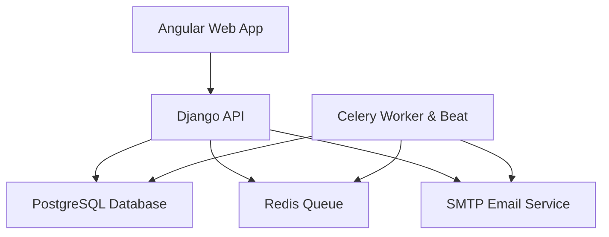
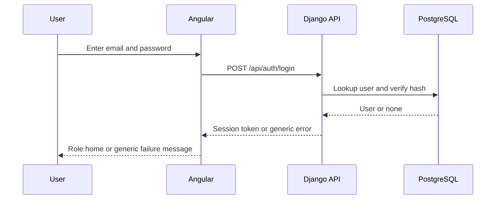
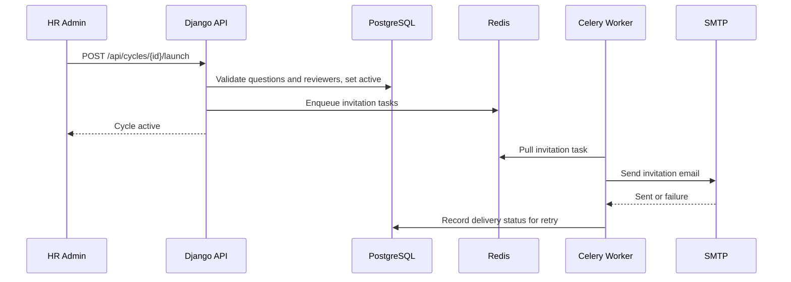
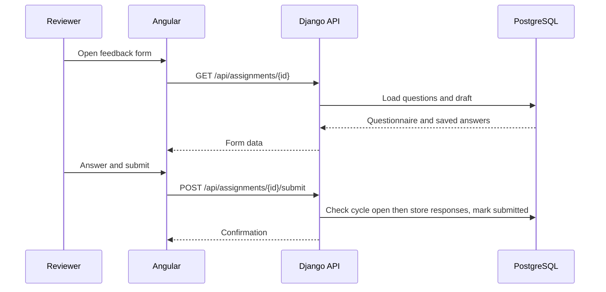
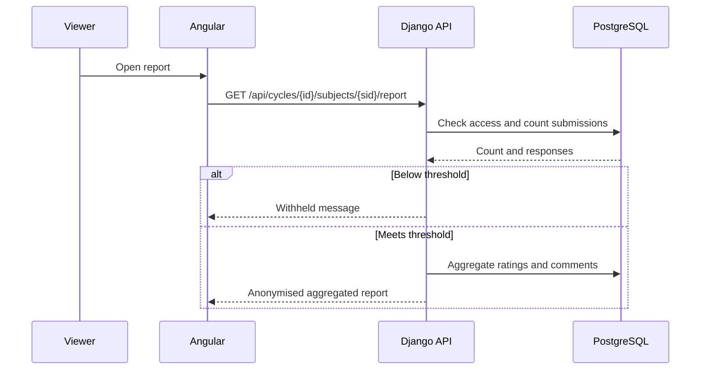
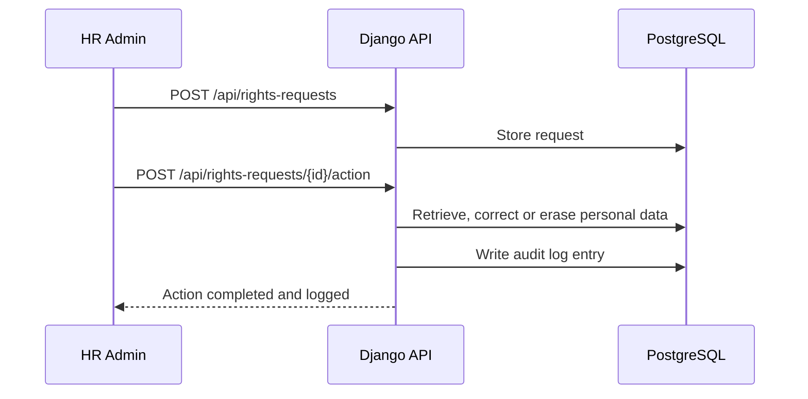
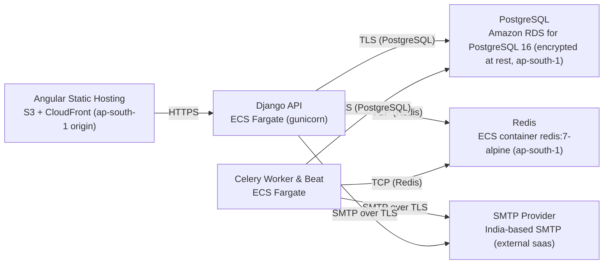

# Architecture

> Maintained by QuorQ AI SDLC. Text between `sdlc:auto` markers is regenerated; anything outside them is yours and is kept.

<!-- sdlc:auto:start narrative -->
## Overview

### ARCH-001 · approved · source: architecture:summary

Approved v1 architecture for a lightweight internal 360° performance management system serving one Indian company under ~200 staff.

HR/admin maintains an employee directory and reporting lines, builds rating-scale/open-text questionnaires, creates and launches feedback cycles with subjects and reviewers. Reviewers are invited and reminded by email and submit anonymous feedback. Subjects, managers, and HR view aggregated reports (gated by a minimum-reviewer threshold to protect anonymity) and export to PDF. Stack: Angular 22 frontend, Django 5.1 REST+admin backend, PostgreSQL 16, Redis-backed Celery workers; deployed entirely in AWS Mumbai (ap-south-1) for DPDP data-residency, with privacy-notice acknowledgement, HR-actioned data-principal rights, and audit logging built in.

- ⚠ Architecture input does not reference specific requirement IDs (US-001..US-022); no explicit requirement-to-architecture traceability was provided, so related_ids could not be populated for any entry in this phase.

### ARCH-002 · approved · source: architecture:components

Six-component system: Angular SPA frontend, Django API/admin backend, Celery worker+beat, PostgreSQL, Redis, and an India-based SMTP provider.

- Frontend: Angular 22 Web App — role-aware UI for sign-in, employee directory, cycle/questionnaire setup, reviewer assignment, feedback submission, aggregated reports, PDF export trigger, HR dashboard, and privacy notice.
- Backend: Django 5.1 Backend (API + Admin) — REST API and Django admin providing email/password auth, role-based access enforcement, directory and reporting-line management with validation, cycle/questionnaire/reviewer logic, anonymity and threshold rules, report aggregation, PDF generation, DPDP notice/rights/audit records; enqueues email jobs.
- Worker: Celery Worker & Beat (Django 5.1 with django-celery-beat) — processes background invitation emails and scheduled reminder nudges off the Redis queue, records delivery failures for HR retry.
- DB: PostgreSQL 16 — strictly-relational store for employees, reporting lines, cycles, questionnaires, reviewer assignments, anonymous responses, audit and DPDP records; enforces FKs and uniqueness; hosted in India.
- Redis: Redis 7 (redis:7-alpine) — message broker for Celery carrying invitation and reminder jobs and the beat schedule.
- SMTP: SMTP Email Service (SaaS) — delivers transactional email (invitations, reminders, password-reset links) via an India-based provider to keep delivery and logs in-country.

### ARCH-003 · approved · source: architecture:critical_paths

Email/password sign-in establishes a role-scoped session and gates everything the app exposes.

User authenticates with email and password; a generic error message is returned on failure to avoid account enumeration. On success a session is established and the user's role determines what is reachable in the UI/API. Sign-out ends the session.

- ⚠ No detail provided on session duration, token mechanism, or password-reset flow linkage to this path.

### ARCH-004 · approved · source: architecture:critical_paths

Launching a configured cycle validates it and triggers asynchronous reviewer invitations.

HR launches a configured feedback cycle. Backend validates a non-empty questionnaire and at least the required subjects/reviewers are present, flips cycle status to active, and enqueues invitation emails which are processed by the Celery worker off the Redis queue. Delivery failures are recorded (email_delivery entity) for HR retry.

**Related:** ARCH-002

### ARCH-005 · approved · source: architecture:critical_paths

Assigned reviewers submit anonymous feedback, with drafts allowed before cycle close.

An assigned reviewer answers the questionnaire, may save a partial draft, and submits before the cycle closes. Responses are stored against the cycle subject but are never exposed with reviewer identity; submission is blocked once the cycle is closed.

### ARCH-006 · approved · source: architecture:critical_paths

Aggregated reports and PDF export are gated by authorisation and a minimum-reviewer anonymity threshold.

An authorised viewer (the subject, their manager, or HR) requests a report. Backend checks authorisation and whether submitted reviewers meet the minimum threshold before aggregating ratings and collating comments with no reviewer identities surfaced. The same threshold rule gates PDF export — no PDF is produced if the report is withheld.

### ARCH-007 · approved · source: architecture:critical_paths

Scheduled and on-demand reminders nudge reviewers who have not yet submitted.

Celery beat fires on a schedule; the worker finds reviewers with outstanding submissions in active cycles and emails reminders, skipping anyone who has already submitted. HR can also trigger the same reminder job on demand via POST /api/cycles/{id}/reminders.

**Related:** ARCH-002

### ARCH-008 · approved · source: architecture:entities

Relational data model spans employees, cycles, questionnaires, reviewer assignments, anonymous responses, and DPDP/audit records.

Entities and key fields:
- employee: id, name, work_email, password_hash, role, manager_id, is_active, created_at
- feedback_cycle: id, name, review_period, start_date, end_date, status, min_reviewer_threshold, created_by
- question: id, cycle_id, text, type, scale_min, scale_max, order
- cycle_subject: id, cycle_id, subject_id
- reviewer_assignment: id, cycle_subject_id, reviewer_id, relationship_type, status, invite_token, submitted_at
- feedback_response: id, assignment_id, question_id, rating_value, text_value, is_draft
- email_delivery: id, assignment_id, kind, status, error, attempted_at
- privacy_notice_acknowledgement: id, employee_id, notice_version, acknowledged_at
- data_rights_request: id, employee_id, type, status, actioned_by, actioned_at, notes
- audit_log: id, actor_id, action, target, detail, created_at
Foreign keys and uniqueness constraints (e.g., manager_id self/circular checks, employee email uniqueness) are enforced in PostgreSQL per the anonymity and reporting-line correctness rules.

### ARCH-009 · approved · source: architecture:endpoints

Full REST API surface covers auth, directory management, cycle lifecycle, feedback submission, reporting, and DPDP operations.

Auth: POST /api/auth/login (generic error on failure), POST /api/auth/logout, POST /api/auth/password-reset/request, POST /api/auth/password-reset/confirm.
Directory: GET /api/employees, POST /api/employees (rejects duplicate email), PATCH /api/employees/{id}, PUT /api/employees/{id}/manager (rejects self/circular reference).
Cycle setup: POST /api/cycles (draft with name/period/dates/threshold), POST /api/cycles/{id}/questions, POST /api/cycles/{id}/subjects (adds subject + reviewers, returns reporting-line suggestions), GET /api/cycles/{id}/subjects/{sid}/reviewer-suggestions.
Cycle lifecycle: POST /api/cycles/{id}/launch (validates questionnaire/reviewers, activates, enqueues invitations), POST /api/cycles/{id}/close (blocks further submissions), POST /api/cycles/{id}/reminders (on-demand reminder trigger).
Feedback: GET /api/assignments/{id} (load questionnaire + draft), PUT /api/assignments/{id}/draft (save partial responses), POST /api/assignments/{id}/submit (blocked if cycle closed).
Reporting: GET /api/cycles/{id}/subjects/{sid}/report (aggregated if authorised and threshold met, else withheld message), GET /api/cycles/{id}/subjects/{sid}/report.pdf (export, none if withheld), GET /api/cycles/{id}/dashboard (submitted-vs-outstanding counts with below-threshold flags).
Ops/DPDP: GET /api/email-failures (recorded delivery failures for retry), POST /api/privacy-notice/acknowledge, POST /api/data-rights-requests (HR records access/correction/erasure request), POST /api/data-rights-requests/{id}/action (HR actions request; erasure anonymises while retaining aggregates; logged).

**Related:** ARCH-003, ARCH-004, ARCH-005, ARCH-006, ARCH-007

### ARCH-010 · approved · source: architecture:deployment_nodes

Entire system deploys in AWS ap-south-1 (Mumbai) to satisfy DPDP data-residency.

- Angular Static Hosting: S3 + CloudFront (dev), serving the Angular 22 build as static files.
- Django App Server: ECS Fargate / EC2 running Django 5.1 on gunicorn.
- Celery Worker + Beat: ECS Fargate / EC2 running Celery with django-celery-beat.
- PostgreSQL: Amazon RDS for PostgreSQL 16.
- Redis: Container (redis:7-alpine) or ElastiCache, Redis 7.
- SMTP Provider: external India-based SMTP over TLS.

**Related:** ARCH-002

- ⚠ Deployment node list mixes 'dev' labeling (S3+CloudFront) with production-grade choices (RDS, ECS) without clarifying which nodes are environment-specific vs. production-final — worth confirming before deployment phase.

### ARCH-011 · approved · source: architecture:technology_decisions

Four approved stack decisions: Angular 22, Django 5.1, PostgreSQL 16, and AWS ap-south-1, each justified against functional and DPDP compliance needs.

- Frontend: Angular 22 (alternatives considered: React, Vue). Serves role-aware screens (directory, cycle setup, feedback forms, reports, HR dashboard) as an SPA against the Django REST API; forms/router support HR/manager/employee UI boundaries and WCAG-aligned accessible components per RPwD Act 2016/GIGW.
- Backend: Django 5.1 (alternatives: FastAPI, Flask). Built-in admin, email/password auth and permissions enforce the three roles and back HR-actioned DPDP access/correction/erasure; model-level validation enforces reporting-line and anonymity-threshold correctness.
- Database: PostgreSQL 16 (alternatives: MySQL, SQLite). Strict foreign keys and uniqueness enforce the highly-relational model (employees→managers, cycles→subjects→reviewers→responses) underpinning anonymity and minimum-reviewer threshold logic; runs in RDS Mumbai for residency.
- Cloud: AWS (alternatives: Azure, GCP). ap-south-1 (Mumbai) keeps all employee and feedback data in India for DPDP residency, with RDS encryption at rest and TLS in transit for sensitive personal data.

- ⚠ DPDP Act and RPwD Act 2016/GIGW are cited as compliance drivers but no explicit industry/domain compliance skill or regulation checklist was supplied in this input; a dedicated compliance traceability review (e.g. confirming which specific DPDP obligations — consent, breach notification, data principal rights timelines — are each covered by a requirement/design/test) has not been performed and should be tracked as an open item.
<!-- sdlc:auto:end narrative -->

<!-- sdlc:auto:start building-blocks -->
## Building Block View

| ID | Name | Technology | Responsibility | Depends on |
|---|---|---|---|---|
| web | Angular Web App | Angular 22 | Role-aware SPA for sign-in, employee directory, cycle/questionnaire setup, reviewer assignment, feedback submission, reports and HR dashboard; presents the privacy notice. | api |
| api | Django API | Django 5.1 (Django REST Framework) | Authentication, role-based access control, directory and reporting-line management, cycle/questionnaire/reviewer logic, anonymity and threshold enforcement, report aggregation and PDF generation, DPDP rights requests and audit logging. | db, queue, email |
| worker | Celery Worker & Beat | Celery on Django 5.1 | Runs background and scheduled jobs: send reviewer invitations on launch, send scheduled/triggered reminders to outstanding reviewers, record delivery failures for HR retry. | queue, db, email |
| db | PostgreSQL Database | PostgreSQL 16 | Strictly relational store for employees, reporting lines, cycles, questionnaires, assignments, responses, email logs, privacy acknowledgements, rights requests and audit logs; enforces anonymity and threshold joins. Encrypted at rest. | — |
| queue | Redis Queue | Redis 7 | Message broker for Celery carrying invitation and reminder tasks so HR is never blocked. | — |
| email | SMTP Email Service | SMTP | Transactional email delivery for reviewer invitations, reminders and password-reset links via an India-based SMTP provider. | — |

<!-- sdlc:auto:end building-blocks -->

<!-- sdlc:auto:start runtime -->
## Runtime View

### Sign-in and role-based access

User authenticates with email/password, receives a session/JWT, and every protected request is checked against the user's role and (for reports) reporting line. Failed sign-in returns a single generic error to avoid account enumeration.

- **Components:** web, api, db
- **Modules:** accounts.views, accounts.permissions, accounts.serializers
- **Key functions:** sign_in(email, password), sign_out(session), has_report_access(user, subject), require_role(roles)

### Launch cycle and invite reviewers

HR launches a configured cycle; the API validates questionnaire and reviewers, marks the cycle active, and enqueues invitation emails to each reviewer via Redis. The worker sends mail over SMTP and records any failure for HR retry.

- **Components:** web, api, db, queue, worker, email
- **Modules:** cycles.views, cycles.services, notifications.tasks, notifications.email_log
- **Key functions:** launch_cycle(cycle_id), validate_questionnaire(cycle), enqueue_invitations(cycle), send_invitation(assignment_id), record_email_failure(assignment_id, error)

### Anonymous feedback submission

A reviewer opens their assigned request, answers rating-scale and open-text questions, can save partial progress, and submits. Responses are stored against the cycle and subject without exposing reviewer identity; submission is blocked once the cycle is closed.

- **Components:** web, api, db
- **Modules:** feedback.views, feedback.serializers, feedback.services
- **Key functions:** get_assignment(token, user), save_draft(assignment_id, answers), submit_feedback(assignment_id, answers), assert_cycle_open(cycle)

### Aggregated report with anonymity threshold

An authorised viewer (subject, their manager or HR) requests a report. The API checks access, counts submitted reviewers, and either returns aggregated ratings plus collated comments with no identities, or withholds it when below the minimum threshold. PDF export reuses the same gate.

- **Components:** web, api, db
- **Modules:** reports.views, reports.aggregation, reports.pdf
- **Key functions:** can_view_report(user, subject, cycle), count_submitted_reviewers(cycle, subject), aggregate_report(cycle, subject), render_report_pdf(report)

### DPDP rights request and audit logging

HR records an access, correction or erasure request against an employee and actions it in-app. Erasure removes personal data while retaining anonymised aggregates that cannot re-identify anyone. Every action and privacy-notice acknowledgement is written to the audit log.

- **Components:** web, api, db
- **Modules:** privacy.views, privacy.services, privacy.audit
- **Key functions:** record_rights_request(employee, type), action_access(employee), action_correction(employee, changes), action_erasure(employee), write_audit(actor, action, target)

<!-- sdlc:auto:end runtime -->

<!-- sdlc:auto:start deployment-view -->
## Deployment View

| Name | Service | Runtime | Scaling | Environment |
|---|---|---|---|---|
| Angular Static Hosting | S3 + CloudFront (ap-south-1 origin) | Static files | CDN | dev |
| Django API | ECS Fargate (gunicorn) | Python 3.12 / Django 5.1 | 1-2 tasks | dev |
| Celery Worker & Beat | ECS Fargate | Python 3.12 / Celery | 1 task | dev |
| PostgreSQL | Amazon RDS for PostgreSQL 16 (encrypted at rest, ap-south-1) | PostgreSQL 16 | single instance | dev |
| Redis | ECS container redis:7-alpine (ap-south-1) | Redis 7 | single instance | dev |
| SMTP Provider | India-based SMTP (external saas) | SMTP | n/a | dev |

| Source | Target | Protocol |
|---|---|---|
| Angular Static Hosting | Django API | HTTPS |
| Django API | PostgreSQL | TLS (PostgreSQL) |
| Django API | Redis | TCP (Redis) |
| Celery Worker & Beat | Redis | TCP (Redis) |
| Celery Worker & Beat | PostgreSQL | TLS (PostgreSQL) |
| Celery Worker & Beat | SMTP Provider | SMTP over TLS |
| Django API | SMTP Provider | SMTP over TLS |

<!-- sdlc:auto:end deployment-view -->

<!-- sdlc:auto:start decisions -->
## Architecture Decisions

| Layer | Choice | ADR |
|---|---|---|
| Frontend | Angular 22 | [ADR-0001](adr/frontend.md) |
| Backend | Django 5.1 | [ADR-0002](adr/backend.md) |
| Database | PostgreSQL 16 | [ADR-0003](adr/database.md) |
| Cloud | AWS | [ADR-0004](adr/cloud.md) |
<!-- sdlc:auto:end decisions -->

<!-- sdlc:auto:start links -->
## Related Documents

- [Data Model](data-model.md)
- [API Specification](api/openapi.yaml)
- [Architecture Decision Records](adr/README.md)
<!-- sdlc:auto:end links -->
