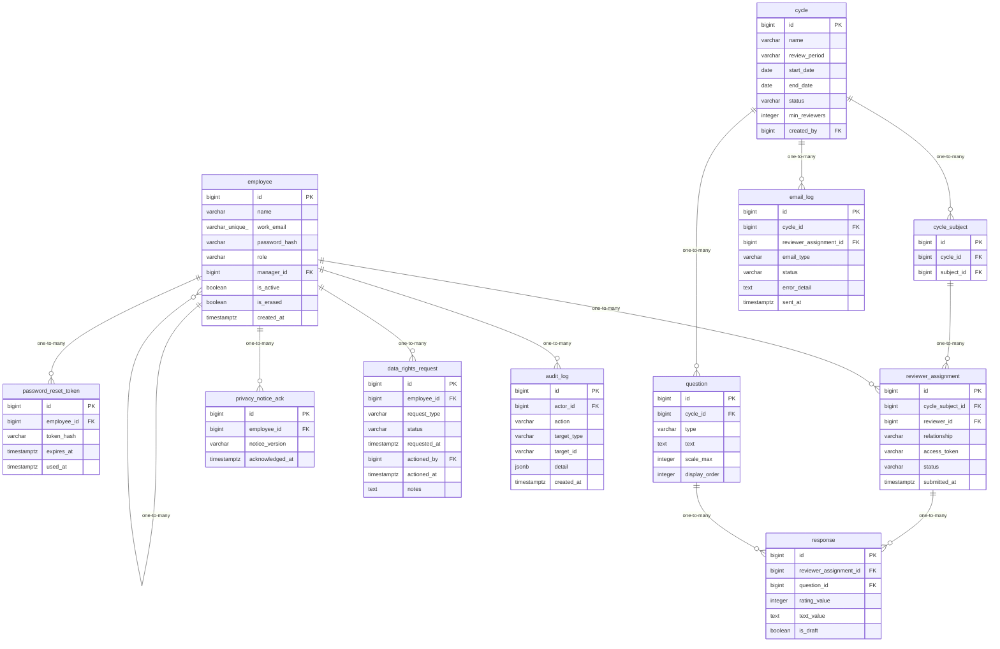

# Data Model

<!-- sdlc:auto:start entities -->
### employee

| Field | Type | PK | FK | Nullable |
|---|---|---|---|---|
| id | bigint | True | — | False |
| name | varchar | False | — | False |
| work_email | varchar(unique) | False | — | False |
| password_hash | varchar | False | — | False |
| role | varchar | False | — | False |
| manager_id | bigint | False | employee.id | True |
| is_active | boolean | False | — | False |
| is_erased | boolean | False | — | False |
| created_at | timestamptz | False | — | False |

### password_reset_token

| Field | Type | PK | FK | Nullable |
|---|---|---|---|---|
| id | bigint | True | — | False |
| employee_id | bigint | False | employee.id | False |
| token_hash | varchar | False | — | False |
| expires_at | timestamptz | False | — | False |
| used_at | timestamptz | False | — | True |

### cycle

| Field | Type | PK | FK | Nullable |
|---|---|---|---|---|
| id | bigint | True | — | False |
| name | varchar | False | — | False |
| review_period | varchar | False | — | False |
| start_date | date | False | — | False |
| end_date | date | False | — | False |
| status | varchar | False | — | False |
| min_reviewers | integer | False | — | False |
| created_by | bigint | False | employee.id | False |

### question

| Field | Type | PK | FK | Nullable |
|---|---|---|---|---|
| id | bigint | True | — | False |
| cycle_id | bigint | False | cycle.id | False |
| type | varchar | False | — | False |
| text | text | False | — | False |
| scale_max | integer | False | — | True |
| display_order | integer | False | — | False |

### cycle_subject

| Field | Type | PK | FK | Nullable |
|---|---|---|---|---|
| id | bigint | True | — | False |
| cycle_id | bigint | False | cycle.id | False |
| subject_id | bigint | False | employee.id | False |

### reviewer_assignment

| Field | Type | PK | FK | Nullable |
|---|---|---|---|---|
| id | bigint | True | — | False |
| cycle_subject_id | bigint | False | cycle_subject.id | False |
| reviewer_id | bigint | False | employee.id | False |
| relationship | varchar | False | — | False |
| access_token | varchar | False | — | False |
| status | varchar | False | — | False |
| submitted_at | timestamptz | False | — | True |

### response

| Field | Type | PK | FK | Nullable |
|---|---|---|---|---|
| id | bigint | True | — | False |
| reviewer_assignment_id | bigint | False | reviewer_assignment.id | False |
| question_id | bigint | False | question.id | False |
| rating_value | integer | False | — | True |
| text_value | text | False | — | True |
| is_draft | boolean | False | — | False |

### email_log

| Field | Type | PK | FK | Nullable |
|---|---|---|---|---|
| id | bigint | True | — | False |
| cycle_id | bigint | False | cycle.id | True |
| reviewer_assignment_id | bigint | False | reviewer_assignment.id | True |
| email_type | varchar | False | — | False |
| status | varchar | False | — | False |
| error_detail | text | False | — | True |
| sent_at | timestamptz | False | — | True |

### privacy_notice_ack

| Field | Type | PK | FK | Nullable |
|---|---|---|---|---|
| id | bigint | True | — | False |
| employee_id | bigint | False | employee.id | False |
| notice_version | varchar | False | — | False |
| acknowledged_at | timestamptz | False | — | False |

### data_rights_request

| Field | Type | PK | FK | Nullable |
|---|---|---|---|---|
| id | bigint | True | — | False |
| employee_id | bigint | False | employee.id | False |
| request_type | varchar | False | — | False |
| status | varchar | False | — | False |
| requested_at | timestamptz | False | — | False |
| actioned_by | bigint | False | employee.id | True |
| actioned_at | timestamptz | False | — | True |
| notes | text | False | — | True |

### audit_log

| Field | Type | PK | FK | Nullable |
|---|---|---|---|---|
| id | bigint | True | — | False |
| actor_id | bigint | False | employee.id | True |
| action | varchar | False | — | False |
| target_type | varchar | False | — | False |
| target_id | varchar | False | — | True |
| detail | jsonb | False | — | True |
| created_at | timestamptz | False | — | False |
<!-- sdlc:auto:end entities -->

<!-- sdlc:auto:start relationships -->
| Source | Target | Type |
|---|---|---|
| employee | employee | one-to-many |
| employee | password_reset_token | one-to-many |
| cycle | question | one-to-many |
| cycle | cycle_subject | one-to-many |
| cycle_subject | reviewer_assignment | one-to-many |
| employee | reviewer_assignment | one-to-many |
| reviewer_assignment | response | one-to-many |
| question | response | one-to-many |
| cycle | email_log | one-to-many |
| employee | privacy_notice_ack | one-to-many |
| employee | data_rights_request | one-to-many |
| employee | audit_log | one-to-many |
<!-- sdlc:auto:end relationships -->

<!-- sdlc:auto:start er-diagram -->

<!-- sdlc:auto:end er-diagram -->
