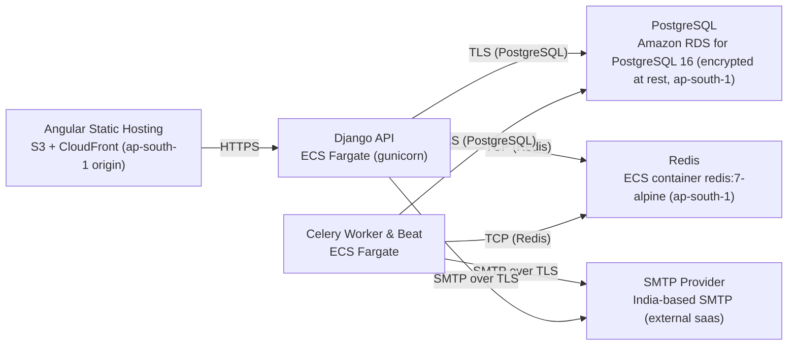

# Deployment Guide

> Maintained by QuorQ AI SDLC. Text between `sdlc:auto` markers is regenerated; anything outside them is yours and is kept.

<!-- sdlc:auto:start how-it-deploys -->
Pushes to `main` run `.github/workflows/deploy.yml`, which builds the API image (if there is a backend) and deploys the SPA to AWS Amplify. Commits touching only `docs/sdlc/**` don't deploy. Deployments can also be started from the platform's Deployment tab.
<!-- sdlc:auto:end how-it-deploys -->

<!-- sdlc:auto:start environments -->
| Name | Service | Runtime | Scaling | Environment |
|---|---|---|---|---|
| Angular Static Hosting | S3 + CloudFront (ap-south-1 origin) | Static files | CDN | dev |
| Django API | ECS Fargate (gunicorn) | Python 3.12 / Django 5.1 | 1-2 tasks | dev |
| Celery Worker & Beat | ECS Fargate | Python 3.12 / Celery | 1 task | dev |
| PostgreSQL | Amazon RDS for PostgreSQL 16 (encrypted at rest, ap-south-1) | PostgreSQL 16 | single instance | dev |
| Redis | ECS container redis:7-alpine (ap-south-1) | Redis 7 | single instance | dev |
| SMTP Provider | India-based SMTP (external saas) | SMTP | n/a | dev |
<!-- sdlc:auto:end environments -->

<!-- sdlc:auto:start live -->
**Frontend URL:** https://pdefb79bdc254.dshared.amplifyapp.local

**Backend URL:** https://defb79bdc254.local.awsapprunner.local

**Database:** PostgreSQL · aisdlc_defb79bdc254

**Version:** 65e950147092

**Commit:** `65e9501`

**Finished:** 2026-11-03
<!-- sdlc:auto:end live -->

<!-- sdlc:auto:start topology -->

<!-- sdlc:auto:end topology -->
